# Risk-to-Case Provenance v2

## Functional outcome

This version removes the ambiguity between exploratory risk runs and operational case selection. A case manager first creates and approves a named risk-result set containing specific completed risk-run IDs for one immutable risk-ready dataset. Candidate generation then reads only the risk-result rows belonging to that approved set. It does not independently recalculate the earlier risk rules.

After candidate review, all candidates must have a human decision. Finalization freezes the selected subset as a versioned case set and creates a durable audit-case record for each selected item. Rejected (`not_selected`) and deferred candidates remain in the decision history but do not enter the final handoff set.

## End-to-end flow

```mermaid
flowchart LR
    XML[Source XML document] --> CAN[Canonical dataset]
    CAN --> DQ[DQ evaluation and publication]
    DQ --> ENR[Enriched dataset]
    ENR --> RR[Risk-ready dataset]
    RR --> R1[Risk run A]
    RR --> R2[Risk run B]
    R1 --> RS[Named risk-result set]
    R2 --> RS
    RS -->|case manager approval| ARS[Approved result set]
    ARS -->|Generate Case Candidates| B[Selection batch]
    B --> DEC[Selected / Not selected / Deferred]
    DEC -->|all decided| CS[Versioned final case set]
    CS --> AC[Audit handoff cases]
    AC --> LIN[Dataset + risk + decision + XML lineage]
```



## Database changes

Migration `platform/migrations/postgresql/011_risk_case_provenance.sql` adds:

| Object | Purpose |
|---|---|
| `cbcr_risk.result_set` | Named, dataset-bound draft/approved collection of risk evidence. |
| `cbcr_risk.result_set_run` | Exact completed risk runs included in the set. |
| `cbcr_selection.selection_batch.risk_result_set_id` | Links candidate generation to its approved evidence set. |
| `cbcr_selection.candidate_source_result` | Links every candidate to the exact `cbcr_risk.result` rows that caused it. |
| `cbcr_selection.case_set` | Immutable, versioned final selection header. |
| `cbcr_selection.case_set_item` | Selected candidates in a final set. |
| `cbcr_selection.audit_case` | Durable operational list for external audit handoff. |
| `cbcr_selection.audit_case_event` | Status history for each audit case. |

The final selected list is therefore queryable independently of a transient UI session.

## API workflow

1. List completed risk runs for a risk-ready dataset: `GET /api/v1/datasets/{dataset_id}/versions/{version}/risk-runs`.
2. Create a draft evidence set: `POST /api/v1/risk-result-sets` with `dataset_id`, `dataset_version`, `name`, `run_ids`, and optional `selection_policy`.
3. Approve it: `POST /api/v1/risk-result-sets/{result_set_id}/approve` with a rationale.
4. Queue `generate_case_candidates` through `POST /api/v1/dataset-runs`. Supply the approved `risk_result_set_id` plus optional `minimum_risk_score`, `allowed_severities`, and `allowed_rules`.
5. Review candidates through `GET /api/v1/selection-batches/{batch_id}/candidates`. The response contains `source_risk_results`.
6. Save `selected`, `not_selected`, or `deferred` decisions through `PUT /api/v1/selection-candidates/{candidate_id}/decision`.
7. Finalize through `POST /api/v1/selection-batches/{batch_id}/finalize` after all candidates have decisions and at least one is selected.
8. List the durable outputs using `GET /api/v1/case-sets` and `GET /api/v1/audit-cases`.
9. Trace a final case using `GET /api/v1/audit-cases/{audit_case_id}/lineage`.

The lineage response contains the complete dataset ancestry, source risk-result records and run IDs, human decision history, audit-case events, and originating XML document metadata where available.

## UI workflow

The Case workbench now has four layers:

1. Risk-result set builder: choose a risk-ready dataset and completed risk runs, create a draft, and approve it.
2. Selection batches: open candidates created from the approved set and save human decisions.
3. Final case sets: finalize a fully decided batch and retain its immutable selected subset.
4. Audit handoff cases: open the end-to-end lineage in the Governance page.

The Administration page exposes an `EDIT CONNECTION` action for source endpoint changes. Passwords remain outside the URL and are resolved through `secret_ref`. For deployment, `CBCR_SOURCE_ENDPOINT` can initialize or update `local_cbcr_postgresql` at startup.

## Deployment configuration

Apply migrations through 011 before starting this version:

```powershell
$env:CBCR_PG_MIGRATION_PASSWORD = '<migration-role-password>'
python platform\tools\pg_apply_migrations.py --database cbcr --confirm-database cbcr
```

For an existing database already migrated through 010, apply only the new additive migration:

```powershell
python platform\tools\pg_apply_migrations.py --from 011 --through 011 --database cbcr --confirm-database cbcr
```

Application variables remain `CBCR_PG_HOST`, `CBCR_PG_PORT`, `CBCR_PG_DATABASE`, `CBCR_PG_USER`, `CBCR_PG_PASSWORD_ENV`, and the secret named by `CBCR_PG_PASSWORD_ENV`. The optional source connection is:

```powershell
$env:CBCR_SOURCE_ENDPOINT = 'postgresql://cbcr_user@postgres-host:5432/cbcr?view=cbcr_canonical.v_api_report_json'
```

Do not put a password in `CBCR_SOURCE_ENDPOINT`. The source catalogue's `secret_ref` identifies the environment variable containing it.

## Compatibility and intentional boundaries

- The original folder remains unchanged.
- Existing SQLite execution remains available. If `risk_result_set_id` is blank, its legacy candidate handler continues to use `minimum_profit_margin`.
- PostgreSQL governed case generation uses the approved risk-result set whenever `risk_result_set_id` is supplied.
- This release does not send cases to an external audit system. It creates an exportable, status-controlled handoff boundary for that later integration.

## Acceptance coverage

`platform/tests_postgresql/test_pg_acceptance.py` verifies migration presence, creation and approval of a result set, governed case generation, risk-result provenance, human decisions, finalization, durable audit cases, and case-to-XML lineage. `platform/tools/pg_verify_schema.py` verifies the new tables, columns, constraints, and indexes.
